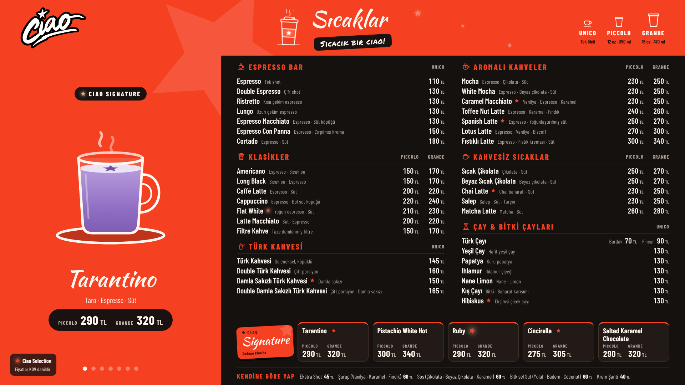
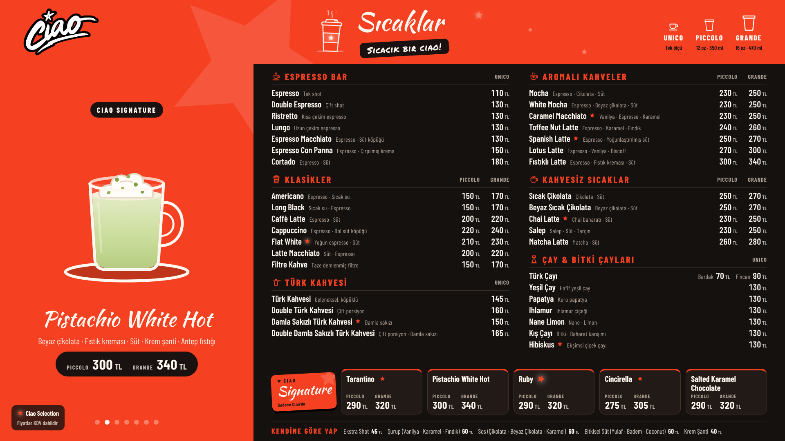
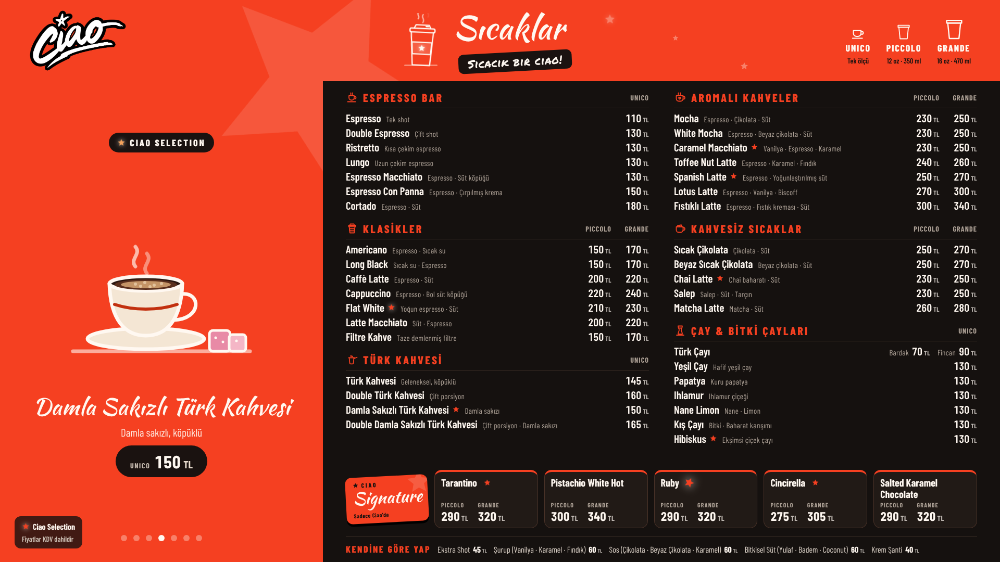
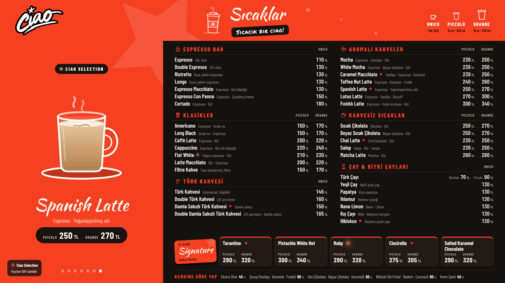
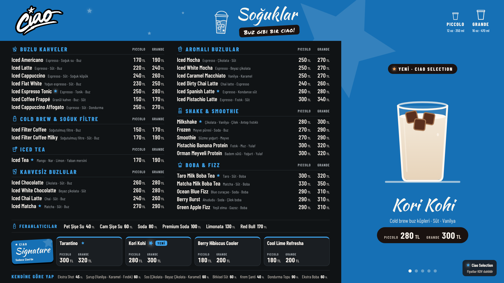
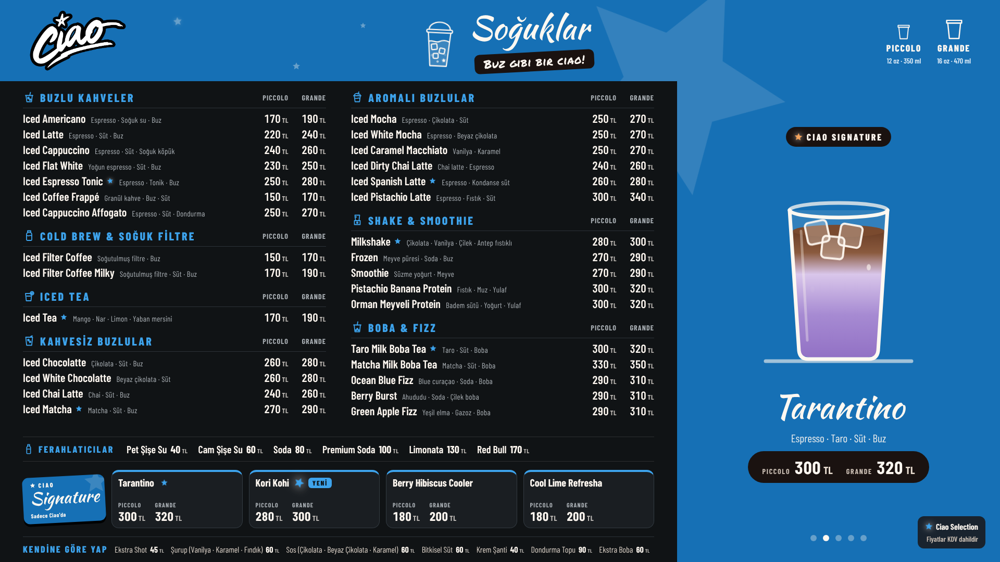
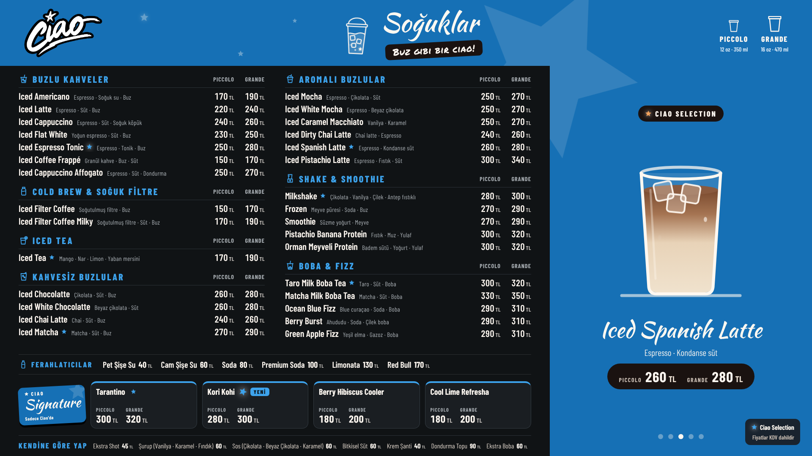
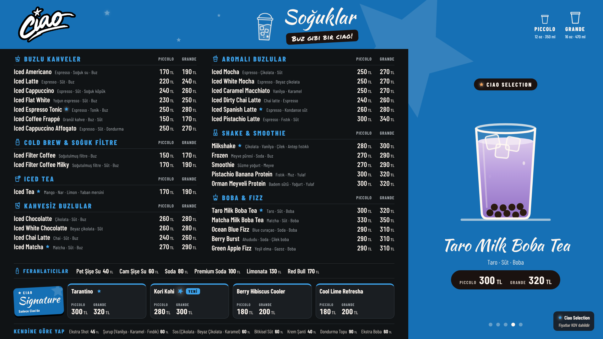
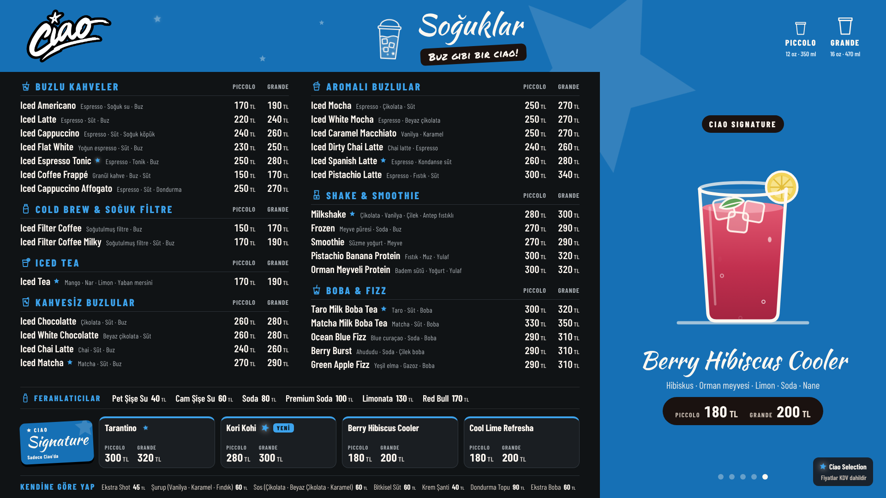

<p align="center">
  
</p>

<h1 align="center">Ciao Caffè — Franchise Brand Identity & Digital Menu System</h1>

<p align="center">
  Corporate franchise identity, in-store digital menu boards, signature drink naming and motion design<br>
  for <a href="https://ciaocaffe.net">Ciao Caffè</a> · designed by <b>Alican Yıldırım</b>
</p>

<p align="center">
  
  
</p>

---

## Project

A complete identity and menu system for a coffee franchise, designed as a system rather than a single poster: one visual language that runs across two simultaneous in-store screens, a printable price list and the till's product list.

| | |
|---|---|
| **Client** | Ciao Caffè — [ciaocaffe.net](https://ciaocaffe.net) |
| **Scope** | Brand identity system · logo usage · digital menu boards (2 × 1920×1080) · motion & illustration · signature drink naming · dessert naming · price list |
| **Design** | Alican Yıldırım — brand, UI/UX, illustration, motion, naming, front-end |
| **Year** | 2026 |
| **Status** | In use in store |

## Highlights

- **Two screens that work as a pair.** Screen 1 loops *intro → hot drinks* (60 s, seven featured drinks). Screen 2 loops *intro → cold drinks → desserts* (60 s). Each opens with an intro in its own colour — red for hot, blue for cold. Both follow the device clock, so two independent screens stay in step without a server, and the dessert board never competes with itself.
- **Motion that tells the product story.** A pitcher or *cezve* arrives and pours from its spout into the centre of the glass, the liquid rises with ripples, ice falls and floats, toppings land on the surface, steam rises — then it rests. Every animation is physically logical and nothing passes through anything else. See [docs/06-motion.md](docs/06-motion.md).
- **A naming system.** Italian size names (UNICO · PICCOLO · GRANDE); the *Ciao Signature* drink line; *Ciao Selection* for barista picks; *Ciao Duetto* for dessert × coffee pairings; and a dessert list renamed after cinema, stage and art — Noir, Altın Lotus, Kuğu Gölü, Moulin Rouge, Roma Tatili… — with the original product name kept underneath for staff.
- **One menu, everywhere.** Names, Ciao Selection marks and prices on the screens match the price list and the till list exactly.
- **Built for real stores.** Each screen is a single offline file with fonts and logo inside; it scales to any display. TVs without a browser get a 60-second video of each loop.

## Inside

```
.
├── brand/
│   ├── logo/          Ciao logo + usage notes
│   ├── fonts/         Barlow Condensed · Kaushan Script · Permanent Marker (with licences)
│   └── tokens/        colours, type scale, layout and motion values (JSON · CSS)
├── docs/              the design system, one topic per file (start at 01)
├── screens/           the menu boards as offline HTML — open in any browser
├── previews/          stills of every board and every product slide
├── video/             60-second loops of both screens (MP4, 1080p)
├── menu/              price list (Excel) — per-board sheets, summary, till list
└── assets/readme/     images for this page
```

## Design system

| | |
|---|---|
| [01 · Brand overview](docs/01-brand-overview.md) | positioning, personality, voice, sub-brands |
| [02 · Logo](docs/02-logo.md) | construction, clear space, minimum size, backgrounds, misuse |
| [03 · Colour](docs/03-color.md) | three board themes, neutrals, illustration palette |
| [04 · Typography](docs/04-typography.md) | three typefaces, roles, type scale, Turkish characters |
| [05 · Components](docs/05-components.md) | every building block of the boards |
| [06 · Motion](docs/06-motion.md) | pour/fill timeline, transitions, ambient loops, easing |
| [07 · Illustration & icons](docs/07-illustration.md) | vector drinkware, toppings, header vectors, icon set |
| [08 · Menu & naming](docs/08-menu-system.md) | sizes, Ciao Signature, Ciao Selection, Ciao Duetto, dessert names |
| [09 · Screen loops](docs/09-screen-loops.md) | two-screen choreography and timing |
| [10 · In-store delivery](docs/10-delivery.md) | what the store receives and how it runs |

## Gallery

| Screen 1 · hot | Screen 2 · cold | Desserts |
|---|---|---|
|  |  |  |
| **Hot list** | **Cold list** | **Intro · hot / cold** |
|  |  |   |

| Hot drinks | | | |
|---|---|---|---|
|  |  |  |  |
|  |  |  | |

| Cold drinks | | | |
|---|---|---|---|
|  |  |  |  |
|  | | | |

## View it

Open [`screens/01_Ekran1_Sicak_Dongu.html`](screens/01_Ekran1_Sicak_Dongu.html) or [`screens/02_Ekran2_Soguk_Dongu.html`](screens/02_Ekran2_Soguk_Dongu.html) in a browser (download the file first — GitHub shows source, not the page). Double-click for full screen. Or watch the loops in [`video/`](video).

## Türkçe özet

Ciao Caffè için hazırlanmış kurumsal franchise marka kimliği ve dijital menü sistemi. İki ekran aynı anda çalışır: **Ekran 1** kırmızı intro + sıcaklar, **Ekran 2** mavi intro + soğuklar + tatlı. İkisi de 60 saniyelik döngüdür ve cihaz saatine göre birlikte ilerler. Ürün görsellerinde döküm, dolum, buz ve buhar animasyonları vardır. Boy isimleri UNICO · PICCOLO · GRANDE; imza içecekler *Ciao Signature*, barista seçimleri *Ciao Selection*, tatlı–kahve eşleşmeleri *Ciao Duetto* olarak adlandırıldı. Tatlılar sinema, sahne ve sanattan, ürünü doğrudan çağrıştıran isimler aldı. Marka sistemi, isimlendirme, illüstrasyon, animasyon ve ekran tasarımı **Alican Yıldırım**'a aittir.

## Credits

**Alican Yıldırım** — brand identity system, logo application, UI/UX and menu board design, illustration, motion design, signature drink and dessert naming, front-end.
[github.com/yildirim-alican](https://github.com/yildirim-alican)

## Licence

**All rights reserved.** This repository is public so the work can be reviewed; it is **not** open source. See [LICENSE](LICENSE) and [NOTICE.md](NOTICE.md).
