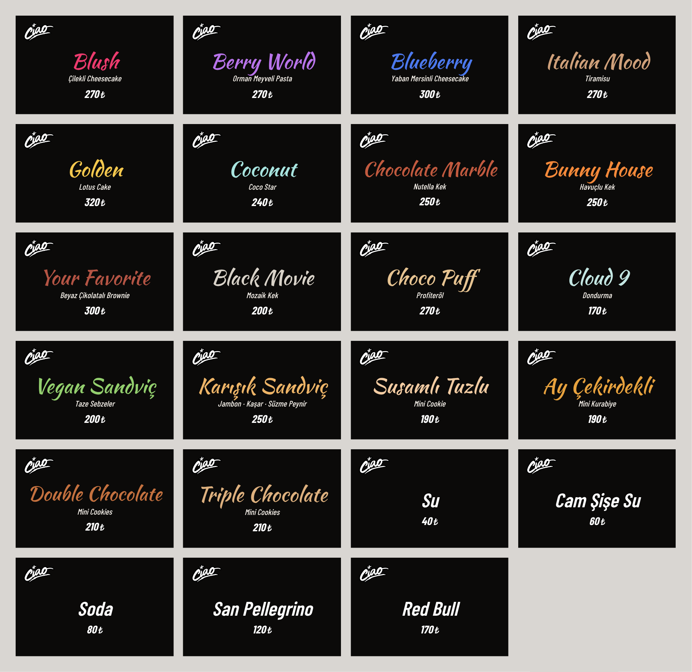
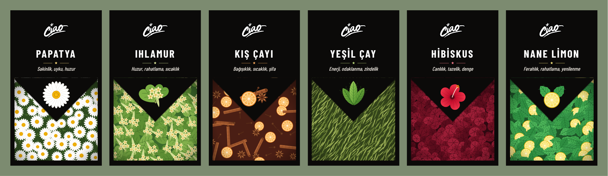

# 12 · Labels

Two label families carry the menu into the store: **price labels** for the display case, the counter and the bar front, and **tea labels** for the herbal-tea jars. Both use the board style — near-black background, the white Ciao logo, Kaushan Script and Barlow Condensed.

## Price labels · 70 × 40 mm

| | |
|---|---|
| Size | **70 × 40 mm** (7 × 4 cm), landscape |
| Background | near-black `#0B0A09`, full bleed |
| Logo | Ciao logo, white, top-left, 8 mm high |
| Name | *Kaushan Script*, ~8.4 mm, in the product's own colour, centred |
| Product name | *Barlow Condensed* Medium italic, ~3.4 mm, white |
| Price | *Barlow Condensed* Bold italic, ~4.7 mm, white, with `₺` |
| Drinks | name in *Barlow Condensed* SemiBold italic, white |

Long names shrink automatically so nothing touches the edge. Each dessert has its own colour, taken from the product (strawberry pink for *Blush*, lotus gold for *Golden*, carrot orange for *Bunny House* …).

| File | Use |
|---|---|
| [`labels/Ciao_Etiketler_A4_7x4cm.pdf`](../labels/Ciao_Etiketler_A4_7x4cm.pdf) | A4, 12 labels per page (2 × 6), crop marks outside a 2 mm bleed. Print at **100 % / actual size**, cut on the marks. |
| [`labels/Ciao_Etiketler_Tekli_7x4cm.pdf`](../labels/Ciao_Etiketler_Tekli_7x4cm.pdf) | for a print shop: one label per 70 × 40 mm page |
| [`labels/png/`](../labels/png) | one PNG per label at 300 dpi (≈ 828 × 475 px) |

**25 labels**

| Group | Labels |
|---|---|
| Pasta & kek | Blush 270 · Berry World 270 · Blueberry 300 · Italian Mood 270 · Golden 320 · Coconut 240 · Chocolate Marble 250 · Bunny House 250 |
| Tatlılar | Your Favorite 300 · Black Movie 200 · Choco Puff 270 · Cookielaton 200 · Cloud 9 170 |
| Sandviçler | Vegan Sandviç 200 · Karışık Sandviç 250 |
| Kasa önü | Susamlı Tuzlu Mini Cookie 190 · Ay Çekirdekli Mini Kurabiye 190 · Double Chocolate Mini Cookies 210 · Triple Chocolate Mini Cookies 210 |
| Bar önü | Su 40 · Cam Şişe Su 60 · Soda 80 · San Pellegrino 120 · Red Bull 170 |
| İçecek | Limonata 200 |

## Tea labels · 70 × 120 mm

Six herbal teas: **Papatya, Ihlamur, Kış Çayı, Yeşil Çay, Hibiskus, Nane Limon**. Names match the hot board.

| | |
|---|---|
| Size | **70 × 120 mm** (7 × 12 cm), portrait |
| Top | logo (13 mm), tea name in *Barlow Condensed* Bold capitals with wide tracking, a star rule in the tea's accent colour, and a three-word benefit line in italic |
| Bottom | a vector illustration panel (64 × 64 mm). A black V cuts into it from the top; the hero ingredient sits inside the V |
| Patterns | drawn, not photographed: chamomile flowers · linden leaves, bracts and blossoms · cinnamon, orange, star anise and clove · dried tea leaves · dried hibiscus calyces · mint leaves and lemon slices |

All artwork is vector, so the labels print sharp at any size and carry no stock-photo licences.

| File | Use |
|---|---|
| [`labels/cay/Ciao_Cay_Etiketleri_A4_7x12cm.pdf`](../labels/cay/Ciao_Cay_Etiketleri_A4_7x12cm.pdf) | A4, 4 labels per page (2 × 2), crop marks, 2 mm bleed. Print at **100 %**. |
| [`labels/cay/Ciao_Cay_Etiketleri_Tekli_7x12cm.pdf`](../labels/cay/Ciao_Cay_Etiketleri_Tekli_7x12cm.pdf) | for a print shop: one label per 70 × 120 mm page |
| [`labels/cay/png/`](../labels/cay/png) | one PNG per label at 300 dpi |

Prices match the screens and [`menu/Ciao_Fiyat_Listesi.xlsx`](../menu/Ciao_Fiyat_Listesi.xlsx). When a price changes, the label is reprinted together with the new screen package.
